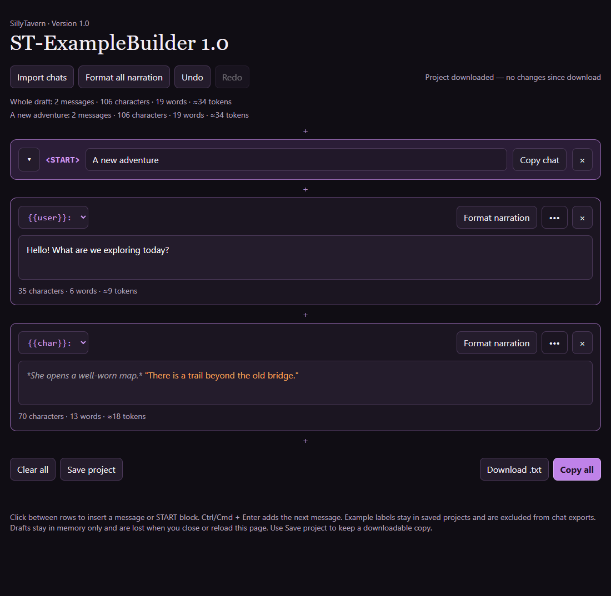

# ST-ExampleBuilder 1.0

A standalone HTML editor for SillyTavern example conversations. Import, edit, and export messages using `{{user}}:`, `{{char}}:`, and `<START>` markers.



## [Open the app on GitHub Pages](https://lunarfyre-st.github.io/Editor-for-SillyTavern-Chat-Examples/)

You can also download `ST-ExampleBuilder-1.0.html` and open it directly in a modern browser; no installation or server is required.

[Download releases](https://github.com/Lunarfyre-ST/Editor-for-SillyTavern-Chat-Examples/releases)

## Using the editor

- Click **Import chats** to either load a `.txt` file or paste properly formatted text into the **Formatted chat text** field, then click **Import**. You can also load a SillyTavern `.jsonl` log or a previously saved project JSON.
- Add, reorder, split, merge, and collapse messages and examples. Format narration and undo or redo edits.
- Use **Copy all** or **Download .txt** to export example conversations for SillyTavern. Example labels are excluded from these exports.
- Use **Save project** to download an editable JSON copy including labels. Import that file to resume later. The save indicator tracks changes since the last project download; copying or exporting text does not mark the project as saved. Your browser may ask before leaving with unsaved changes.

Both pasted text and `.txt` files use the same format:

```text
<START>
{{user}}: Hello!
{{char}}: Hi! How can I help?
```

Begin each message with `{{user}}:` or `{{char}}:`. Put `<START>` on its own line to separate examples; if you omit it, the text is imported as one example. Messages can span multiple lines.

Token counts are estimates. SillyTavern JSONL logs can be imported too: choose the messages to keep, then import them as an example. System messages and log metadata are excluded.

## 🎭 ImmersiveGroups

Want to give your SillyTavern chats a visual novel feel? Check out [ImmersiveGroups](https://github.com/Lunarfyre-ST/ImmersiveGroups) for character sprites, outfit changes, and backgrounds, and browse the [ImmersiveGroups Library](https://github.com/Lunarfyre-ST/ImmersiveGroups-Library) for character sets and assets.

## Privacy and saving

Chat text and labels stay in the page's memory. The app has no analytics, external dependencies, network requests, cookies, or automatic draft storage. It removes the draft storage key used by older versions on startup, without restoring its contents.

Closing or reloading the page loses the draft, so download a project before leaving. Exported files and text copied to your clipboard can contain personal information you entered; manage those copies yourself.

When accessed online, GitHub Pages still receives normal hosting requests; use the downloaded HTML offline if you prefer. Browser extensions, browser recovery features, and the operating system are outside the app's control.
